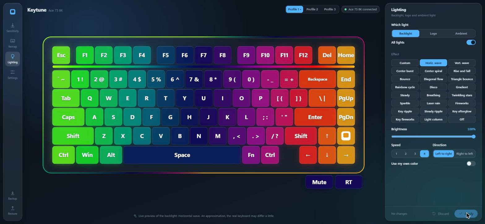
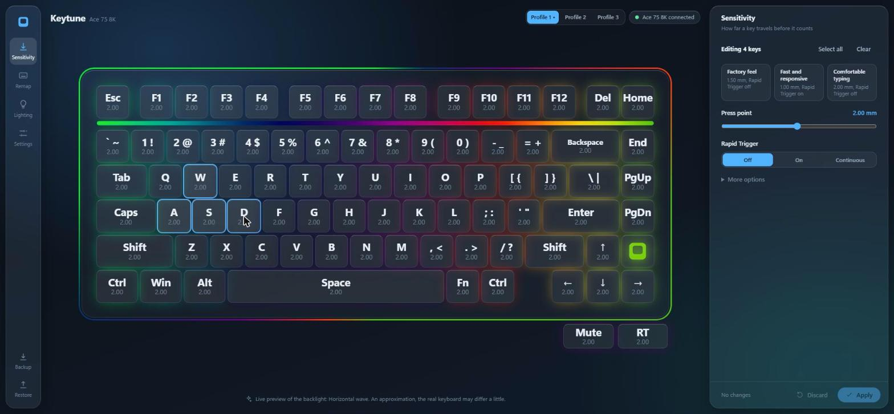
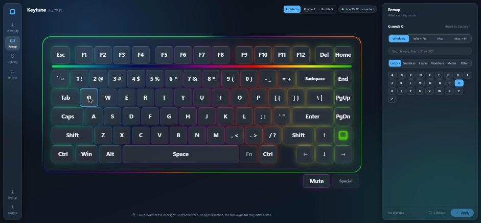

# Keytune

Keytune is a fast, English web app for tuning MCHOSE magnetic keyboards: how far a key has to travel before it counts, what each key sends, and every light. It runs in your browser, there is nothing to install, and nothing you do is uploaded.

It was made because the official MCHOSE app (M HUB) is slow and only in Chinese. Keytune is an unofficial community project and is not affiliated with MCHOSE.

**Open it here: https://momkay.github.io/keytune/**

## What you need
- A **computer** (Windows, macOS, Linux or ChromeOS). There is no phone or tablet version, because a keyboard is set up from a computer.
- **Chrome or Edge**. Firefox and Safari cannot talk to keyboards this way.
- Your keyboard plugged in with the **USB cable**. It does not work over Bluetooth or the 2.4 GHz dongle.
- The official MCHOSE app or website **closed**. Only one program can talk to the keyboard at a time.

Verified keyboard: **MCHOSE Ace 75 8K**. Other MCHOSE models are shown read-only until someone has tested them (see "Other keyboards" below).

## Getting started
1. Open the link above in Chrome or Edge, in a window at least 1100 x 600 pixels (it fits on one screen from 1366 x 768 up).
2. Plug the keyboard in and press **Connect keyboard**.
3. Chrome opens a small window with a list of devices. Select **all the entries that belong to your keyboard** and press Connect. Chrome only lets a page do this after you click, so it is normal that you must do it.
4. Your keyboard appears on screen. Click keys, change things, then press **Apply** (bottom right).

The next time you open the page it normally connects by itself. If it does not (for example after a different browser profile or a permissions reset), press Connect again.

## What you can change
Four sections on the left, and a keyboard picture in the middle. Pick keys on the picture, change things on the right.

**Sensitivity.** Click a key, or hold Ctrl or Shift to pick several, or press "Select all". Set the *press point* in millimetres (how far you press before it counts) and turn on *Rapid Trigger*, which makes a key react the moment you move it up or down again. "Continuous" Rapid Trigger keeps tracking all the way. One-click presets are at the top: *Factory feel*, *Fast and responsive* and *Comfortable typing*. "More options" has the separate press and release distances and the dead zones near the top and bottom of the travel.

**Remap.** Choose what a key sends. There are four layers: Windows, Windows + Fn, Mac and Mac + Fn. Pick a key on the picture, then pick what it should send: a letter, number, F key, modifier or media key (or search by name). "Reset to factory" puts that key back. Keys that send something special (like the Fn key) are shown as locked on purpose.

**Lighting.** The backlight has 22 effects with brightness, speed, direction and your own colour. The logo light and the ambient light (the strip around and under the keys) have their own choices, and one switch turns all lights on or off. The **Custom** effect lets you paint keys one at a time: choose a brush colour, click keys, press Apply. Your colours are saved in the keyboard, so they stay after you unplug it. The picture is a live preview that moves like the real lights; it is a close approximation, not a perfect copy.

**Settings.** Reporting speed (1k to 8k), Rapid Trigger smoothing, the double-press filter (debounce), Windows-key lock and how long until the keyboard sleeps.

**Profiles.** The keyboard stores three profiles. The buttons at the top show them, and a dot marks the one the keyboard is using right now. You can look at any profile, and "Use Profile 2" makes the keyboard use it. For now only Profile 1 can be edited.

## Nothing happens until you press Apply
Changes you make are only *staged*: the picture shows them, and the bar at the bottom says what is waiting. Press **Apply** to send them to the keyboard, or **Discard** to throw them away.

## Backups, and getting things back
- Before your **first change** in each visit, Keytune saves a backup file to your Downloads folder (`keytune-backup-<number>.json`). It holds your key settings, remaps, lighting, colours and settings.
- **Backup** (bottom left) saves another one whenever you like.
- **Restore** loads a backup file. It does not write anything by itself: it stages the differences so you can look at them, and then you press Apply.
- Every write is checked by reading it back from the keyboard. If anything does not match you are told in red, and the backup is there to restore from.

Keep your backup files somewhere safe. They contain only your keyboard settings, nothing personal.

## If something goes wrong
- **"Could not connect" or nothing in the device list:** close the official MCHOSE app or website, unplug and replug the keyboard, and press Connect again. Use a data USB cable (some cables only charge).
- **The page says my browser cannot talk to keyboards:** open it in Chrome or Edge on a computer.
- **"... is not supported yet":** your model is not in the list. Nothing was read or changed. Press *Copy report* and share it (see below).
- **A yellow bar says the model has not been checked:** you can look around and save a backup, but changes are switched off on purpose.
- **A key feels wrong after a change:** press Restore and pick your backup, then Apply. Or use the *Factory feel* preset.

## Safety
- Keytune only sends a short list of known commands. It can never update firmware, enter boot mode or reset the keyboard, and the update interface of the keyboard is never opened.
- Every write needs a backup first, is range-checked, is read back and compared.
- The page has no server and loads nothing from the internet while you use it.
- It still changes the memory inside your keyboard: **use it at your own risk.**

## Other keyboards
A keyboard Keytune does not know is never read or written, but it can produce a small report with its USB ids (nothing personal) that helps add it. A model that is known but untested is read-only until someone checks it on real hardware. If you own one and want to help, see [docs/ADDING_A_MODEL.md](docs/ADDING_A_MODEL.md).

## For developers
How it works, the keyboard protocol, the code layout, tests and how to release: [docs/DEVELOPING.md](docs/DEVELOPING.md). Protocol evidence: [PROTOCOL.md](PROTOCOL.md). Contributing: [CONTRIBUTING.md](CONTRIBUTING.md). Security: [SECURITY.md](SECURITY.md). Changes: [CHANGELOG.md](CHANGELOG.md).

## Licence
MIT, see [LICENSE](LICENSE).
