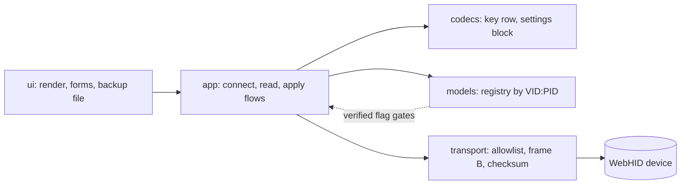

# Architecture

## Overview

Static ES modules, no bundler. The page imports `src/ui/app.js`. Everything below `ui` is plain functions that run in Node for tests; only `transport/device.js` touches `navigator.hid`.

## Components
| Name | Responsibility | Depends on |
|---|---|---|
| `src/transport/frame-b.js` | build request packet, parse reply, checksum (sum of length, offset bytes, data, & 0xFF), use the reply's own length byte | none |
| `src/transport/allowlist.js` | the only list of sendable commands; rejects the rest | none |
| `src/transport/device.js` | open the config interface, `exchange(cmd, offset, len, data)`, timeouts; the **only** file calling `sendReport` | frame-b, allowlist |
| `src/codecs/key.js` | 8-byte key row <-> object (actuation, RT, deadzones, keyMode) | none |
| `src/codecs/func.js` | 64-byte settings block <-> object, bit-level edit helpers | none |
| `src/models/*.js` | one profile per model: VID/PID, usage page filter, KEYMAP, limits, polling-rate values, `verified` | none |
| `src/app/*.js` | connect, read, backup, diff, apply with read-back (the write flow) | transport, codecs, models |
| `src/ui/*.js` | DOM rendering and events; elements are built with `dom.js` `h()` (text nodes only), innerHTML is banned everywhere; `session.js` holds all keyboard work | app |
| `test/` | mock HID device, golden vectors from real keyboard bytes, flow tests | all |

## Data model
- `Backup`: `{ device, profile, readAt, infoHex[], funcHex[64], keysHex[1024] }`.
- `ModelProfile`: `{ id, name, vendorId, productId, verified, keymap: [[row, name]...], limits, rates, frame: "B" }`.
- Live state: `funcBlock` (64 bytes) and `keyTable` (128 x 8 bytes) of profile 0.

## Key decisions
**ADR-1 No bundler, JSDoc types.** Context: static hosting, tiny code. Choice: ES modules + `tsc --checkJs`. Rejected: React/Vite (build weight, no benefit). Consequence: types live in comments; tests run directly in Node.
**ADR-2 One send point plus allowlist.** Context: a public page that writes to hardware. Choice: only `device.js` may call `sendReport`, and only allowlisted commands pass. Rejected: trusting the UI layer. Consequence: a bug in the UI cannot send a firmware command.
**ADR-3 Verified flag gates writes.** Context: one test keyboard. Choice: models are read-only until hardware-verified. Rejected: enabling writes everywhere. Consequence: adding a model is safe by default.
**ADR-4 Frame A deferred.** The "qhw" frame (report ID 77, XOR checksum) is documented in PROTOCOL.md but unverified; implement it only when a qhw model is available to test.
**ADR-5 Official data stays out of the repo.** `analysis/` is gitignored; model KEYMAPs are our own verified data files.

## Layout
```
index.html        page shell + CSP meta
src/ui/app.js     entry (page shell); src/session.js = load, backup, stage, apply
src/transport/    frame-b.js, allowlist.js, device.js
src/codecs/       key.js, func.js
src/models/       index.js (registry), ace75-8k.js
src/app/          flows (connect, read, backup, apply)
src/ui/           app, keyboard, panels, controls, dom, pending, picker
test/             *.test.js, mock-device.js, vectors.js
docs/             SPEC, ARCHITECTURE, PLAN
analysis/         (gitignored) official JS for reading
```

## Cross-cutting
- Errors: thrown `Error` with a plain-English message; the UI shows it in the status line, never swallows it.
- Timeouts: 1.5 s per exchange (reads and writes), no automatic retry of writes.
- Config/secrets: none. No network calls at runtime.
- Logging: console only, no persistence.
